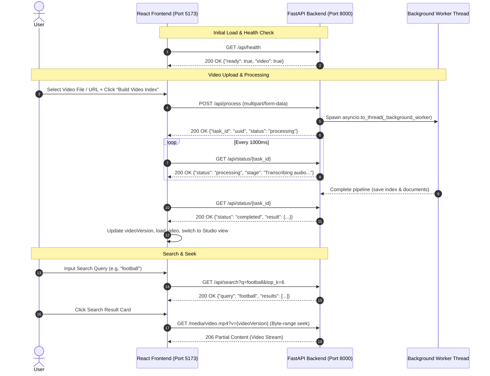

# Project Context & Technical Specification: Secure Vision

> Comprehensive architectural, algorithmic, and operational documentation of the Secure Vision codebase.

---

## 1. Directory & File Structure

```text
moment-seek/
├── .gitignore
├── README.md
├── PROJECT_CONTEXT.md
├── backend/
│   ├── api.py
│   ├── app.py
│   └── requirements.txt
├── docs/
│   └── images/
│       ├── landing_page.png
│       ├── studio_view.png
│       └── upload_view.png
└── frontend/
    ├── index.html
    ├── package.json
    ├── package-lock.json
    ├── vite.config.js
    └── src/
        ├── main.jsx
        └── styles.css
```

*(Note: Runtime data files `backend/data/` or `data/`, virtual environments `venv/`, `node_modules/`, and `__pycache__/` are excluded from version control).*

---

## 2. Source Files & Component Responsibilities

### Backend Files (`backend/`)

#### [`backend/api.py`](file:///c:/Users/brixx/Desktop/Moment-seek/moment-seek/backend/api.py)
FastAPI HTTP server providing the REST API and background task processing for the React frontend.
- **`app = FastAPI(...)`**: Initializes the FastAPI instance with CORS middleware supporting `localhost:5173`, `127.0.0.1:5173`, `localhost:5174`, and `127.0.0.1:5174`.
- **`app.mount("/media", ...)`**: Exposes the `backend/data/` directory statically at `/media` for video streaming and frame image preview.
- **`public_frame_url(path: str | None) -> str | None`**: Formats an internal disk path for an extracted frame into a public HTTP URL (`/media/frames/<filename>`).
- **`health() -> dict`**: Handler for `GET /api/health`. Checks if an existing FAISS index (`index.faiss`), document metadata (`documents.json`), and video file (`video.mp4`) exist.
- **`_background_worker(task_id: str, video_path: Path, interval: float) -> None`**: Target worker function invoked in a separate background thread via `asyncio.to_thread`. Calls `process_pipeline` with a progress callback and updates the `tasks` state dictionary.
- **`process_video(...) -> dict`**: Handler for `POST /api/process`. Accepts uploaded video files (`multipart/form-data`) or YouTube/video URLs, saves the target video to `backend/data/video.mp4`, generates a UUID task ID, and initiates asynchronous background processing.
- **`get_task_status(task_id: str) -> dict`**: Handler for `GET /api/status/{task_id}`. Returns current stage, status (`processing`, `completed`, `failed`), errors, and pipeline summary metrics.
- **`search(q: str, top_k: int = 6) -> dict`**: Handler for `GET /api/search`. Loads the `all-MiniLM-L6-v2` SentenceTransformer model and FAISS index, computes the query vector embedding, performs L2 distance similarity search, and returns ranked moment cards with timestamps and frame image URLs.

#### [`backend/app.py`](file:///c:/Users/brixx/Desktop/Moment-seek/moment-seek/backend/app.py)
Core multimodal video processing pipeline and standalone CLI runner.
- **`download_video(url: str, destination: Path, cookies: Path | None = None) -> Path`**: Downloads a video from a URL using `yt-dlp`, with stream selection (`bestvideo+bestaudio/best`), temp file handling, and atomic renaming.
- **`ensure_ffmpeg() -> str`**: Locates `ffmpeg.exe` via `PATH`, `FFMPEG_PATH` environment variable, or standard Windows WinGet package directories, ensuring it is present and executable.
- **`extract_frames(video: Path, frame_dir: Path, interval: float) -> list[dict]`**: Executes FFmpeg as a subprocess (`-vf fps=1/{interval}`) to extract high-quality JPEG frames at constant timestamp intervals.
- **`transcribe(video: Path, device: str) -> list[dict]`**: Uses OpenAI Whisper (`base` model) to transcribe speech from the video audio track into timestamped text segments.
- **`caption_frames(frames: list[dict], device: str) -> list[dict]`**: Runs Salesforce BLIP (`Salesforce/blip-image-captioning-base`) conditional generation to generate descriptive natural language captions for all extracted image frames.
- **`build_index(documents: list[dict], index_path: Path, metadata_path: Path) -> None`**: Computes 384-dimensional dense vector embeddings using `SentenceTransformer("all-MiniLM-L6-v2")`, constructs a FAISS `IndexFlatL2` index, and persists the index binary and metadata JSON.
- **`search(query: str, index_path: Path, metadata_path: Path, top_k: int) -> None`**: CLI helper to embed a query and print ranked matches in the terminal.
- **`process_pipeline(video: Path, data_dir: Path, interval: float = 5.0, progress_callback: callable | None = None) -> dict`**: Orchestrates end-to-end processing across FFmpeg, Whisper, BLIP, and FAISS, notifying callers of stage progression.
- **`main() -> None`**: CLI entry point parsing command-line flags (`--video`, `--url`, `--query`, `--interval`, `--top-k`, `--cookies`, `--data-dir`).

#### [`backend/requirements.txt`](file:///c:/Users/brixx/Desktop/Moment-seek/moment-seek/backend/requirements.txt)
Python package manifest listing all backend runtime dependencies.

---

### Frontend Files (`frontend/`)

#### [`frontend/index.html`](file:///c:/Users/brixx/Desktop/Moment-seek/moment-seek/frontend/index.html)
Minimal Single-Page Application (SPA) HTML container that mounts the root DOM node (`<div id="root"></div>`) and imports `/src/main.jsx`.

#### [`frontend/vite.config.js`](file:///c:/Users/brixx/Desktop/Moment-seek/moment-seek/frontend/vite.config.js)
Vite build and development server configuration. Configures `@vitejs/plugin-react` and fixes the development server to port `5173`.

#### [`frontend/package.json`](file:///c:/Users/brixx/Desktop/Moment-seek/moment-seek/frontend/package.json)
Frontend project configuration, scripts (`dev`, `build`, `preview`), and dependencies (`react`, `react-dom`, `lucide-react`, `vite`, `@vitejs/plugin-react`).

#### [`frontend/src/main.jsx`](file:///c:/Users/brixx/Desktop/Moment-seek/moment-seek/frontend/src/main.jsx)
Primary React UI application component managing full state, view transitions, API calls, and user interactions.
- **State Management**:
  - `currentView`: Active navigation tab (`'landing'` | `'upload'` | `'studio'`).
  - `file`, `url`, `interval`: Upload input parameters.
  - `busy`, `message`: Processing and searching progress status indicators.
  - `isIndexed`, `stats`: Indexing completion status and dataset metrics.
  - `query`, `results`, `activeMoment`: Search input, ranked results array, and currently selected moment.
  - `currentTime`: Current playback timestamp in seconds.
  - `videoVersion`: Timestamp-based cache buster token for the video player source URL.
  - `showSkeletons`: Diagnostic preview toggle for skeleton loading states.
- **Key Functions**:
  - `formatTime(seconds)`: Formats numeric seconds into `MM:SS.S`.
  - `checkHealth()` (via `useEffect`): Queries `GET /api/health` on mount; auto-transitions to the Studio view if an active index already exists on disk.
  - `processVideo(event)`: Submits video file/URL to `POST /api/process`, starts a 1-second interval poller on `GET /api/status/{taskId}`, and redirects to Studio on completion.
  - `searchVideo(event)`: Dispatches query to `GET /api/search` and populates the ranked results list.
  - `seekTo(timestamp, result)`: Sets HTML5 video player playhead to the given timestamp and triggers playback.
  - `resetWorkspace()`: Clears active state and routes back to the Upload view.

#### [`frontend/src/styles.css`](file:///c:/Users/brixx/Desktop/Moment-seek/moment-seek/frontend/src/styles.css)
Custom CSS design system defining dark mode theme variables, typography (`Space Grotesk`, `Syne`, `DM Sans`, `DM Mono`), 3D button press physics, slider styles, CSS keyframe animations (e.g. frame ejection hero animation), skeleton loaders, and responsive grid layouts.

---

## 3. Full Request Flow & API Specification

The frontend connects to the backend at `http://127.0.0.1:8000`.



### Endpoints Detail

| Endpoint | Method | Request Format / Parameters | Response Schema | Status Codes |
| :--- | :--- | :--- | :--- | :--- |
| **`/api/health`** | `GET` | None | `{"ready": boolean, "video": boolean}` | `200` |
| **`/api/process`** | `POST` | `multipart/form-data`<br>• `video`: File (optional)<br>• `url`: string (optional)<br>• `interval`: float (default `5.0`)<br>• `cookies`: File (optional) | `{"task_id": string, "status": "processing"}` | `200`, `400` (missing input), `500` (processing error) |
| **`/api/status/{task_id}`** | `GET` | Path parameter: `task_id` (UUID string) | `{"task_id": string, "status": "processing" \| "completed" \| "failed", "stage": string, "error": string \| null, "result": {"ok": true, "frames": number, "segments": number, "device": string} \| null}` | `200`, `404` (task not found) |
| **`/api/search`** | `GET` | Query parameters:<br>• `q`: string (query text)<br>• `top_k`: integer (default `6`) | `{"query": string, "results": [{"text": string, "timestamp": number, "distance": number, "frame": string \| null}]}` | `200`, `409` (index not ready) |
| **`/media/{file_path}`** | `GET` | Path parameter: Static file path (e.g. `video.mp4`, `frames/frame_000001.jpg`)<br>Query parameter: `?v={videoVersion}` (cache-busting token) | Binary stream / partial content (supports HTTP 206 Range headers) | `200`, `206`, `404`, `416` |

---

## 4. Full Data Pipeline

From raw video to dense vector search, data passes through 8 discrete pipeline stages:

```
[1. Video Ingestion]
      │  yt-dlp (URL download) OR Python shutil stream copy (local file upload)
      ▼
[2. Frame Extraction]
      │  FFmpeg subprocess (fps=1/{interval}, JPEG quality scale 2)
      ▼
[3. Audio Transcription]
      │  OpenAI Whisper ('base' model, fp16 on CUDA / fp32 on CPU)
      ▼
[4. Visual Captioning]
      │  Salesforce BLIP ('Salesforce/blip-image-captioning-base', max_new_tokens=40)
      ▼
[5. Document Aggregation & Sorting]
      │  Merge Auditory ("Auditory: ...") and Visual ("Visual: ...") entries, sorted by timestamp
      ▼
[6. Dense Text Embedding]
      │  SentenceTransformers ('all-MiniLM-L6-v2', 384-dimensional dense vectors)
      ▼
[7. Vector Indexing & Serialization]
      │  FAISS (IndexFlatL2 Euclidean distance index) -> saved to index.faiss & documents.json
      ▼
[8. Query Execution & Playback]
         Query embedded via all-MiniLM-L6-v2 -> FAISS L2 nearest neighbor search -> Seek playhead
```

1. **Video Ingestion**: Local file uploaded via multipart form is written to disk at `backend/data/video.mp4`. For URLs, `yt-dlp` downloads the best video/audio streams into a temporary file and atomically renames it.
2. **Frame Extraction**: `ensure_ffmpeg()` locates `ffmpeg.exe`. FFmpeg samples 1 frame every `N` seconds (`-vf fps=1/{interval}`) saved as `backend/data/frames/frame_%06d.jpg`.
3. **Audio Transcription**: `openai-whisper` (`base` model) extracts speech audio segments with start/end timestamps and text.
4. **Visual Frame Captioning**: `Salesforce/blip-image-captioning-base` (`BlipProcessor` + `BlipForConditionalGeneration`) evaluates each extracted JPEG image and generates natural language captions prefixed with `"Visual: "`.
5. **Document Aggregation**: Audio segments (prefixed with `"Auditory: "`) and visual captions are merged into a single document list and sorted chronologically by timestamp.
6. **Dense Text Embedding**: `SentenceTransformer("all-MiniLM-L6-v2")` transforms all document strings into 384-dimensional float32 vector embeddings.
7. **Vector Indexing**: FAISS (`IndexFlatL2`) indexes the vectors and writes `backend/data/index.faiss`. Raw documents and metadata are written to `backend/data/documents.json`.
8. **Similarity Search**: When a user queries a term, `api.py` encodes the query string with `all-MiniLM-L6-v2` and calls `index.search(vector, top_k)` to retrieve nearest items by L2 distance.

---

## 5. Third-Party Dependencies

### Python Dependencies ([`backend/requirements.txt`](file:///c:/Users/brixx/Desktop/Moment-seek/moment-seek/backend/requirements.txt))
*All Python packages are currently unpinned to track compatible updates:*
- `yt-dlp`: Video/audio stream downloading from YouTube and other media providers.
- `numpy`: Numerical array manipulation and float32 vector formatting.
- `opencv-python`: Computer vision utilities and image array operations.
- `openai-whisper`: Speech recognition and audio transcription model.
- `transformers`: Hugging Face library providing the BLIP conditional captioning model and processor.
- `sentence-transformers`: Dense embedding generation via `all-MiniLM-L6-v2`.
- `faiss-cpu`: Dense vector similarity index and L2 nearest-neighbor search.
- `torch` & `torchvision`: Deep learning backend for PyTorch, CUDA device execution, and tensor transforms.
- `Pillow`: Image opening, conversion to RGB, and processing for BLIP.
- `fastapi`: Async HTTP web framework.
- `uvicorn[standard]`: ASGI web server implementation.
- `python-multipart`: Streaming parser for `multipart/form-data` file uploads.

### Frontend Dependencies ([`frontend/package.json`](file:///c:/Users/brixx/Desktop/Moment-seek/moment-seek/frontend/package.json))
*Frontend dependencies are declared with `latest`:*
- `react`: Core React library for UI rendering and hooks.
- `react-dom`: DOM renderer for React.
- `lucide-react`: SVG icon library for UI controls.
- `vite`: Build tool and local development server.
- `@vitejs/plugin-react`: Vite plugin for React JSX compilation and Fast Refresh.

---

## 6. Hardcoded Values & Locations

| Category | Value | File & Line Location |
| :--- | :--- | :--- |
| **API Base URL** | `'http://127.0.0.1:8000'` | [`frontend/src/main.jsx:6`](file:///c:/Users/brixx/Desktop/Moment-seek/moment-seek/frontend/src/main.jsx#L6) |
| **Vite Dev Port** | `5173` | [`frontend/vite.config.js:6`](file:///c:/Users/brixx/Desktop/Moment-seek/moment-seek/frontend/vite.config.js#L6) |
| **CORS Origins** | `http://localhost:5173`, `http://127.0.0.1:5173`, `http://localhost:5174`, `http://127.0.0.1:5174` | [`backend/api.py:38-41`](file:///c:/Users/brixx/Desktop/Moment-seek/moment-seek/backend/api.py#L38-L41) |
| **SentenceTransformer Model** | `"all-MiniLM-L6-v2"` | [`backend/api.py:130`](file:///c:/Users/brixx/Desktop/Moment-seek/moment-seek/backend/api.py#L130), [`backend/app.py:141,157`](file:///c:/Users/brixx/Desktop/Moment-seek/moment-seek/backend/app.py#L141) |
| **Whisper Model** | `"base"` | [`backend/app.py:109`](file:///c:/Users/brixx/Desktop/Moment-seek/moment-seek/backend/app.py#L109) |
| **BLIP Model** | `"Salesforce/blip-image-captioning-base"` | [`backend/app.py:118,120`](file:///c:/Users/brixx/Desktop/Moment-seek/moment-seek/backend/app.py#L118) |
| **BLIP Max Tokens** | `max_new_tokens=40` | [`backend/app.py:127`](file:///c:/Users/brixx/Desktop/Moment-seek/moment-seek/backend/app.py#L127) |
| **Default Frame Interval** | `5.0` seconds | [`backend/api.py:83`](file:///c:/Users/brixx/Desktop/Moment-seek/moment-seek/backend/api.py#L83), [`backend/app.py:171,219`](file:///c:/Users/brixx/Desktop/Moment-seek/moment-seek/backend/app.py#L171), [`frontend/src/main.jsx:13`](file:///c:/Users/brixx/Desktop/Moment-seek/moment-seek/frontend/src/main.jsx#L13) |
| **Default Search Query** | `"missile launch"` | [`backend/app.py:217`](file:///c:/Users/brixx/Desktop/Moment-seek/moment-seek/backend/app.py#L217), [`frontend/src/main.jsx:14`](file:///c:/Users/brixx/Desktop/Moment-seek/moment-seek/frontend/src/main.jsx#L14) |
| **Default Top K Matches** | `top_k: int = 6` (API) / `5` (CLI) | [`backend/api.py:127`](file:///c:/Users/brixx/Desktop/Moment-seek/moment-seek/backend/api.py#L127), [`backend/app.py:218`](file:///c:/Users/brixx/Desktop/Moment-seek/moment-seek/backend/app.py#L218), [`frontend/src/main.jsx:126`](file:///c:/Users/brixx/Desktop/Moment-seek/moment-seek/frontend/src/main.jsx#L126) |
| **Default YouTube URL** | `"https://www.youtube.com/watch?v=CiVelfKFtcQ"` | [`backend/app.py:16`](file:///c:/Users/brixx/Desktop/Moment-seek/moment-seek/backend/app.py#L16) |
| **FFmpeg Quality Parameter** | `"-q:v", "2"` | [`backend/app.py:96`](file:///c:/Users/brixx/Desktop/Moment-seek/moment-seek/backend/app.py#L96) |
| **Polling Rate** | `1000` ms | [`frontend/src/main.jsx:112`](file:///c:/Users/brixx/Desktop/Moment-seek/moment-seek/frontend/src/main.jsx#L112) |
| **Data Directory Paths** | `DATA = ROOT / "data"`, `VIDEO = DATA / "video.mp4"`, `FRAMES = DATA / "frames"`, `INDEX = DATA / "index.faiss"`, `DOCUMENTS = DATA / "documents.json"` | [`backend/api.py:22-27`](file:///c:/Users/brixx/Desktop/Moment-seek/moment-seek/backend/api.py#L22-L27) |

---

## 7. Known Limitations & Technical Debt

1. **In-Memory Background Task Storage**:
   - `tasks: dict[str, dict] = {}` in `backend/api.py` is held strictly in Python process memory. If Uvicorn restarts or reloads, active task states are lost.
2. **Single-Tenant / Single-Video State**:
   - The backend paths are singleton (`backend/data/video.mp4`, `backend/data/index.faiss`, etc.). Processing a new video overwrites the previous index and video on disk. Concurrent processing across multiple clients is not supported.
3. **Unpinned Dependency Manifests**:
   - `requirements.txt` and `package.json` do not lock package versions (using unpinned names or `latest`), which may cause environment drift across new installations.
4. **Absence of Authentication / Authorization**:
   - Endpoints and static media routes have no authentication, user isolation, or rate limiting.
5. **Model Loading Overhead on Search**:
   - In `backend/api.py:search()`, `model = SentenceTransformer("all-MiniLM-L6-v2")` and `index = faiss.read_index(...)` are loaded on each search request rather than cached as application-level singletons.
6. **Documentation Sync**:
   - `README.md` contains legacy references to port `8001`, `web/` instead of `frontend/`, and root-level `api.py` / `app.py`. The active implementation uses port `8000` and the `backend/` + `frontend/` directory structure.

---

## 8. Local Environment Setup & Execution Guide

### Prerequisites
- **Python**: 3.10 or higher
- **Node.js**: 18.0 or higher
- **FFmpeg**: Installed and available in system `PATH` (or specified via `FFMPEG_PATH`)

---

### Step 1: Backend Setup & Execution

1. Open a terminal and navigate to the project directory:
   ```bash
   cd moment-seek
   ```
2. Create and activate a Python virtual environment:
   - **Windows (PowerShell)**:
     ```powershell
     python -m venv venv
     .\venv\Scripts\Activate.ps1
     ```
   - **Linux / macOS**:
     ```bash
     python -m venv venv
     source venv/bin/activate
     ```
3. Install Python dependencies:
   ```bash
   pip install -r backend/requirements.txt
   ```
4. Navigate into `backend` and start the FastAPI server on port `8000`:
   ```bash
   cd backend
   uvicorn api:app --reload --host 127.0.0.1 --port 8000
   ```
   *Backend is live at: `http://127.0.0.1:8000`*

---

### Step 2: Frontend Setup & Execution

1. Open a second terminal window and navigate to the `frontend` directory:
   ```bash
   cd moment-seek/frontend
   ```
2. Install npm dependencies (first run only):
   ```bash
   npm install
   ```
3. Start the Vite development server:
   ```bash
   npm run dev
   ```
   *Frontend is live at: `http://localhost:5173` or `http://127.0.0.1:5173`*

---

### Step 3: CLI Execution (Alternative to Web Interface)

To process a video and search moments directly in the terminal:
```bash
cd backend
..\venv\Scripts\activate

# Index a local video and run a query
python app.py --video path/to/video.mp4 --query "football" --interval 3.0

# Index a YouTube URL and run a query
python app.py --url "https://www.youtube.com/watch?v=CiVelfKFtcQ" --query "football" --interval 5.0
```
